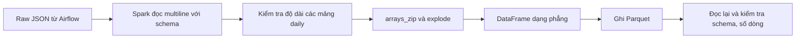

# Bài 5 — Xử lý batch với Apache Spark

## Mục tiêu

- Hiểu cách Spark đọc dữ liệu JSON theo batch bằng DataFrame.
- Khai báo schema rõ ràng thay vì phụ thuộc hoàn toàn vào schema inference.
- Xử lý JSON nhiều dòng bằng tùy chọn `multiLine`.
- Ghép các mảng dữ liệu `daily` theo cùng vị trí và trải thành các dòng phẳng.
- Ghi dữ liệu sang Parquet và đọc lại để kiểm tra.

## Luồng dữ liệu



Spark chạy trong Docker riêng tại [spark/docker-compose.yml](../../spark/docker-compose.yml). Airflow vẫn chịu trách nhiệm ingest, nạp PostgreSQL và dbt; job Spark trong bài này chạy độc lập trên thư mục raw.

## Dữ liệu đầu vào

Batch kiểm chứng là ngày `2026-10-27`, gồm 5 file JSON:

- `can-tho`
- `da-nang`
- `hanoi`
- `ho-chi-minh-city`
- `hue`

Mỗi file có metadata ở cấp ngoài và payload Open-Meteo ở `payload.daily`. Các trường dùng trong bài:

- `daily.time`
- `daily.temperature_2m_mean`
- `daily.precipitation_sum`
- `daily.wind_speed_10m_max`

## Mã nguồn

Job nằm tại [spark/jobs/weather_batch.py](../../spark/jobs/weather_batch.py). Các phần chính:

1. `WEATHER_SCHEMA` mô tả kiểu dữ liệu của metadata và payload.
2. `spark.read.option("multiLine", True)` đọc đúng mỗi file JSON nhiều dòng thành một bản ghi.
3. `arrays_zip` ghép ngày với ba mảng chỉ số theo cùng vị trí.
4. `explode` chuyển mỗi phần tử ngày thành một dòng.
5. Kiểm tra độ dài mảng trước khi biến đổi để phát hiện dữ liệu không đồng nhất.
6. Ghi Parquet vào `/data/output/weather_daily`.
7. Đọc lại Parquet và so sánh số dòng với DataFrame trước khi ghi.

## Cách chạy

Từ thư mục gốc repository:

```powershell
Set-Location spark
docker compose run --rm spark
```

Compose mount các thư mục sau:

- `data/raw/airflow/2026-10-27` → `/data/input`
- `data/processed/spark` → `/data/output`
- `spark/jobs` → `/opt/spark/jobs`

## Kết quả đã xác nhận

- Spark version: `3.5.3`.
- Đọc thành công 5 file JSON.
- Tạo 5 dòng đầu ra, mỗi dòng tương ứng một thành phố.
- Ghi Parquet thành công.
- Đọc lại Parquet thành công với 5 dòng.
- Schema đầu ra có các trường thành phố, ngày quan sát, nhiệt độ trung bình, lượng mưa và tốc độ gió tối đa.

## Lỗi đã gặp và cách xử lý

### JSON được format nhiều dòng

Spark mặc định giả định mỗi dòng là một JSON object. Raw JSON của pipeline được format nhiều dòng, nên phải dùng:

```python
raw_df = (
    spark.read.option("multiLine", True)
    .schema(WEATHER_SCHEMA)
    .json("/data/input/*.json")
)
```

Nếu bỏ `multiLine`, Spark có thể đọc sai cấu trúc và tạo các bản ghi không hợp lệ.

### Các mảng daily không cùng độ dài

Không nên lấy phần tử ở chỉ số cố định nếu API có thể trả nhiều ngày. Job kiểm tra độ dài các mảng, sau đó dùng `arrays_zip` để giữ đúng quan hệ giữa ngày và chỉ số.

## Bài học rút ra

- Schema rõ ràng giúp kiểm soát kiểu dữ liệu và phát hiện dữ liệu sai sớm.
- JSON là định dạng thuận tiện cho raw data nhưng Parquet phù hợp hơn cho dữ liệu phân tích.
- Spark DataFrame dùng phép biến đổi lười; hành động như `count`, `show`, `write` mới kích hoạt việc thực thi.
- Dữ liệu sinh ra như Parquet không nên commit vào Git; chỉ commit mã nguồn, cấu hình và tài liệu.

## Bài tập tự ôn

1. Đổi đường dẫn input sang một batch ngày khác và chạy lại job.
2. Thêm một cột `temperature_f` từ `mean_temperature_c`.
3. Thêm kiểm tra không cho phép nhiệt độ hoặc lượng mưa bị null.
4. Giải thích vì sao `multiLine` cần thiết trong job này.
5. Giải thích sự khác nhau giữa `DataFrame.transform` và hành động `write` trong Spark.

## Tiêu chí hoàn thành

- Chạy job không lỗi.
- Hiểu schema đầu vào và schema đầu ra.
- Giải thích được `multiLine`, `arrays_zip`, `explode` và Parquet.
- Xác nhận số dòng đầu vào và đầu ra hợp lý.
