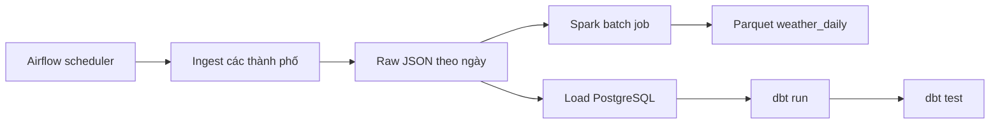
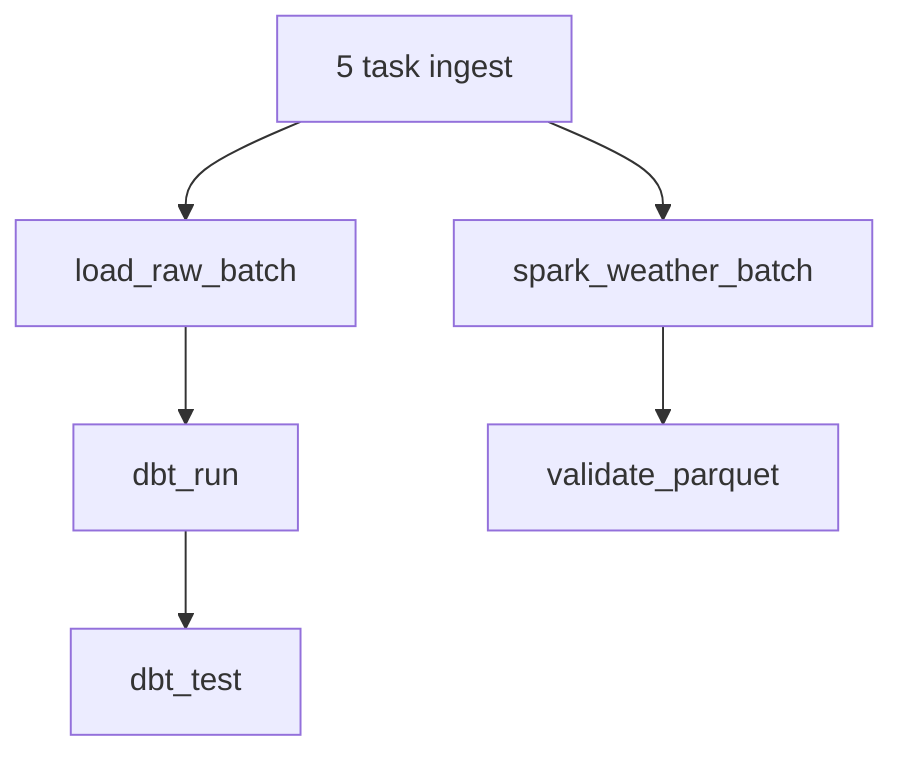

# Bài 6 — Điều phối Spark bằng Airflow

## Mục tiêu

- Hiểu cách Airflow điều phối một Spark job.
- Phân biệt scheduler của Airflow với Spark runtime.
- Xác định dependency giữa raw JSON và bước xử lý Parquet.
- Truyền ngày dữ liệu từ Airflow vào job thay vì hard-code ngày.
- Theo dõi log, retry và kiểm tra đầu ra của Spark task.

## Kiến trúc



Airflow là hệ thống điều phối, không phải nơi thực hiện toàn bộ xử lý dữ liệu. Spark vẫn chạy bằng runtime riêng; Airflow chỉ quyết định khi nào job bắt đầu, nhận trạng thái thành công/thất bại và retry khi cần.

## Vì sao chưa sửa DAG ngay?

Hiện repository có hai Compose stack:

- `airflow/docker-compose.yml` chạy scheduler, API server và các service Airflow.
- `spark/docker-compose.yml` chạy một Spark container độc lập.

Một task Airflow không nên tự gọi `docker compose` bên trong scheduler nếu chưa cấu hình Docker socket hoặc Spark service/network đúng cách. Bài này sẽ lần lượt cấu hình runtime rồi mới thêm dependency vào DAG, tránh tình trạng task thành công giả nhưng không tạo được Parquet.

## Kế hoạch thực hành

1. Đổi Spark job từ đường dẫn ngày cố định sang biến môi trường hoặc tham số ngày.
2. Chọn cách chạy Spark từ Airflow: SparkSubmitOperator với Spark runtime dùng chung, hoặc DockerOperator với cấu hình Docker socket được kiểm soát.
3. Tạo task `spark_weather_batch` sau các task ingest.
4. Kiểm tra đầu ra Parquet sau khi Spark hoàn tất.
5. Cho phép `dbt_run` và `spark_weather_batch` chạy song song sau `load_raw_batch` nếu không có dependency trực tiếp.
6. Kiểm tra log task và thử retry bằng cách tạo một lỗi có kiểm soát.

## Workflow dự kiến



Trong workflow này, Spark chỉ cần raw JSON nên có thể chạy sau khi ingest hoàn tất. `dbt_run` vẫn phụ thuộc vào `load_raw_batch`; hai nhánh có thể chạy song song nếu tài nguyên máy cho phép.

## Chuẩn bị

Đảm bảo bài Spark độc lập vẫn chạy thành công:

```powershell
Set-Location spark
docker compose run --rm spark
```

Kiểm tra Airflow stack:

```powershell
Set-Location ..
docker compose --env-file airflow/.env -f airflow/docker-compose.yml ps
```

## Tiêu chí hoàn thành

- Spark task xuất hiện trong DAG và có dependency đúng.
- Airflow chạy thành công từ ingest đến Parquet.
- Log cho biết input directory, output directory và số dòng.
- Parquet được kiểm tra sau task Spark.
- Có thể giải thích vì sao Airflow không thay thế Spark và vì sao Spark không nên được cài tùy tiện vào scheduler.
