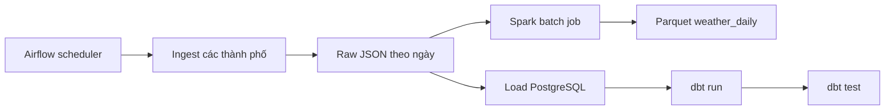
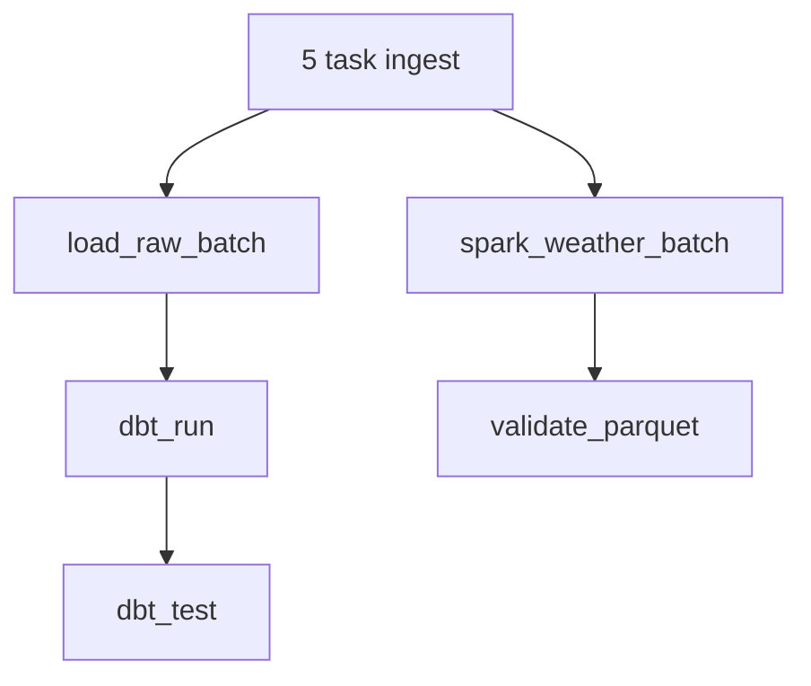

# Bài 6 — Điều phối Spark bằng Airflow

## Mục tiêu

- Hiểu cách Airflow điều phối một Spark job.
- Phân biệt scheduler của Airflow với Spark runtime.
- Xác định dependency giữa raw JSON và bước xử lý Parquet.
- Truyền ngày dữ liệu từ Airflow vào job thay vì hard-code ngày.
- Theo dõi log, retry và kiểm tra đầu ra của Spark task.

## Kiến trúc



Airflow là hệ thống điều phối, không phải nơi thực hiện toàn bộ xử lý dữ liệu. Spark vẫn chạy bằng runtime riêng; Airflow chỉ quyết định khi nào job bắt đầu, nhận trạng thái thành công/thất bại và retry khi cần.

## Quyết định kiến trúc local

Repository có hai Compose stack:

- `airflow/docker-compose.yml` chạy scheduler, API server và các service Airflow.
- `spark/docker-compose.yml` chạy Spark độc lập để kiểm tra job.

Đối với môi trường học tập local, image Airflow được bổ sung Java 17 và một virtual environment riêng chứa PySpark 3.5.3. DAG gọi trực tiếp `/home/airflow/spark-venv/bin/spark-submit` bằng `PythonOperator`. Cách này không cần Docker socket trong scheduler và không để task tự gọi `docker compose`.

Job Spark nhận `--input` và `--output`, vì vậy DAG có thể truyền thư mục theo ngày dữ liệu của từng DAG run thay vì hard-code ngày.

## Kế hoạch thực hành

1. Đổi Spark job từ đường dẫn ngày cố định sang biến môi trường hoặc tham số ngày.
2. Build image Airflow có Java 17 và Spark venv riêng.
3. Tạo task `spark_weather_batch` sau các task ingest.
4. Job tự đọc lại Parquet và kiểm tra số dòng sau khi ghi.
5. Cho phép nhánh Spark và nhánh PostgreSQL/dbt chạy song song sau ingest.
6. Kiểm tra log task và xác nhận trạng thái DAG run.

## Workflow dự kiến



Trong workflow này, Spark chỉ cần raw JSON nên có thể chạy sau khi ingest hoàn tất. `dbt_run` vẫn phụ thuộc vào `load_raw_batch`; hai nhánh có thể chạy song song nếu tài nguyên máy cho phép.

## Chuẩn bị

Đảm bảo bài Spark độc lập vẫn chạy thành công:

```powershell
Set-Location spark
docker compose run --rm spark
```

Kiểm tra Airflow stack:

```powershell
Set-Location ..
docker compose --env-file airflow/.env -f airflow/docker-compose.yml ps
```

## Chạy và xác minh toàn bộ DAG

1. Khởi động PostgreSQL của dự án tại cổng host `5433`, sau đó khởi động Airflow:

   ```powershell
   docker compose up -d postgres
   docker compose --env-file airflow/.env -f airflow/docker-compose.yml up -d
   ```

2. Mở `http://localhost:8080`, vào DAG `weather_daily_pipeline`, rồi chọn **Trigger**. Lần chạy thủ công không luôn có `data_interval_end`; DAG dùng ngày UTC hiện tại làm mốc dự phòng và xử lý batch của ngày UTC liền trước.
3. Mở DAG run vừa tạo, xem trạng thái từng task và log. Các task ingest phải hoàn tất trước khi `spark_weather_batch` và `load_raw_batch` chạy. `dbt_run` theo sau `load_raw_batch`, rồi `dbt_test`.
4. DAG run chỉ hoàn tất khi ở trạng thái **success**. Kiểm tra đủ năm task ingest, `spark_weather_batch`, `load_raw_batch`, `dbt_run` và `dbt_test` đều thành công.
5. Spark output được lưu tại `data/processed/spark/<ngày-batch>`; raw JSON tại `data/raw/airflow/<ngày-batch>`. Loader ghi dữ liệu vào PostgreSQL, dbt tạo và kiểm tra các model.

### Khắc phục lỗi thường gặp

- Nếu `load_raw_batch` không kết nối được, kiểm tra container PostgreSQL dự án đang chạy và port mapping `5433:5432`; từ container Airflow, host kết nối là `host.docker.internal:5433`.
- Nếu chạy thủ công gặp `KeyError: 'data_interval_end'`, cập nhật DAG để có ngày dự phòng cho manual run, build lại và khởi động lại các service Airflow.
- Nếu DAG run đang queued, kiểm tra DAG có bị pause hoặc có run khác chiếm `max_active_runs=1` hay không.

## Kết quả xác minh

Đã trigger DAG thủ công với run ID `full-integration-fixed-20261103`. Run hoàn tất ở trạng thái **success**; cả năm task ingest, `spark_weather_batch`, `load_raw_batch`, `dbt_run` và `dbt_test` đều thành công. `dbt_test` báo 7 kiểm thử đạt, không có lỗi.

## Tiêu chí hoàn thành

- Spark task xuất hiện trong DAG và có dependency đúng.
- Image Airflow có Java 17 và PySpark 3.5.3 trong venv riêng.
- DAG thủ công chạy thành công xuyên suốt ingest → Spark/PostgreSQL → dbt.
- Log cho biết input directory, output directory và số dòng.
- Parquet được đọc lại và kiểm tra trong job Spark.
- Có thể giải thích vì sao Airflow điều phối Spark thay vì thay thế Spark.
