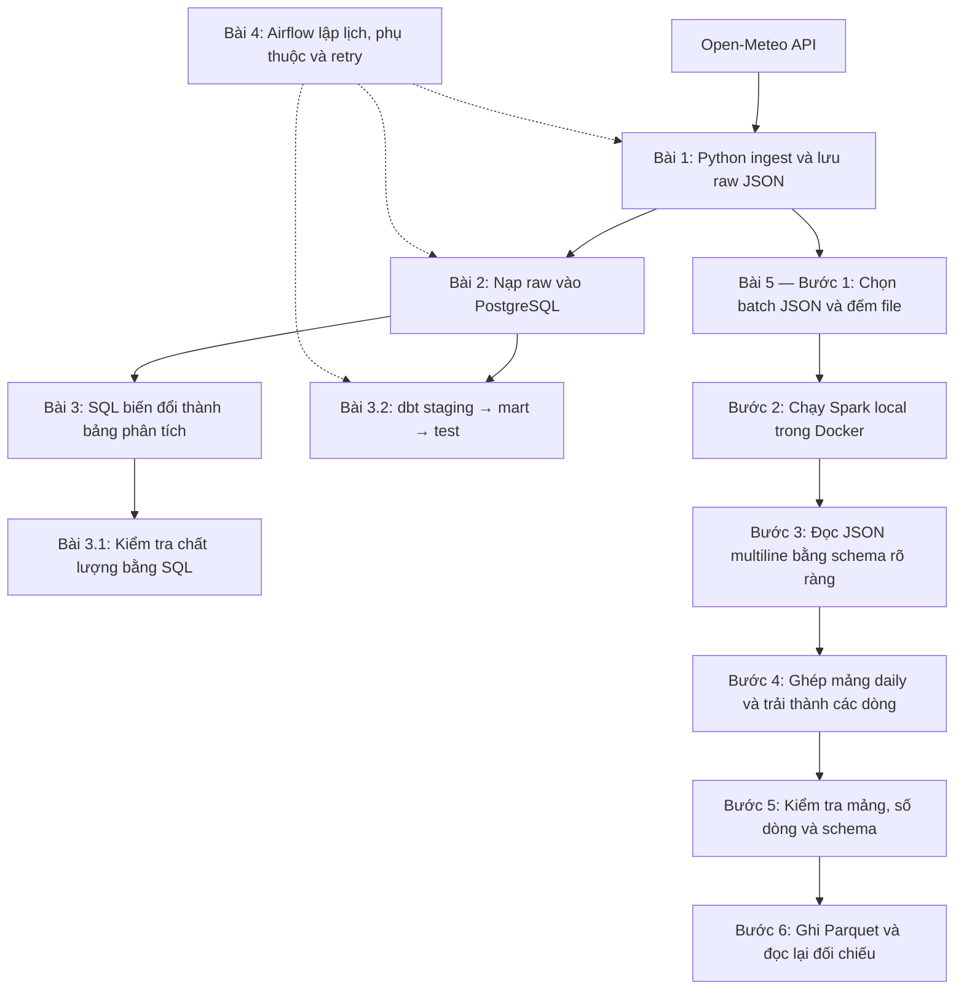

# Bài 5 — Xử lý dữ liệu batch với Apache Spark

> Bài đã hoàn thành. Xem [tài liệu ôn tập chi tiết](../docs/lessons/05-spark-batch-processing.md) để xem lại mục tiêu, lỗi đã gặp, kết quả kiểm chứng và bài tập mở rộng.

Trong bài này, bạn sẽ dùng PySpark để đọc các file JSON thô do pipeline Airflow tạo ra, biến đổi dữ liệu thời tiết thành bảng có cấu trúc và ghi kết quả Parquet. Bài chạy Spark local trong Docker để làm quen với DataFrame và tư duy xử lý phân tán mà chưa cần cluster thật.

## Workflow tổng quan

Sơ đồ phân biệt **luồng dữ liệu** (mũi tên liền) với **điều phối tác vụ** (mũi tên nét đứt). Spark là nhánh đọc trực tiếp raw JSON, không đọc đầu ra dbt.



**Đầu vào bài 5:** batch JSON do Airflow tạo, mỗi file tương ứng một thành phố. **Đầu ra dự kiến:** dữ liệu Parquet với các cột thành phố, ngày, nhiệt độ, lượng mưa và tốc độ gió.

Airflow hiện chỉ điều phối ingest → nạp PostgreSQL → dbt run → dbt test, chưa tự chạy Spark. Bài Spark được chạy độc lập bằng Compose trong [spark/docker-compose.yml](docker-compose.yml).

## Mục tiêu

- Hiểu vai trò của Spark và PySpark trong xử lý dữ liệu quy mô lớn.
- Đọc nhiều file JSON thành một DataFrame có schema rõ ràng.
- Dùng phép biến đổi DataFrame để trích các chỉ số thời tiết.
- Ghi kết quả sang Parquet và kiểm tra khả năng đọc lại.

## Dữ liệu đầu vào

Airflow lưu raw JSON theo cấu trúc `data/raw/airflow/<ngày>/<ngày>_<city_key>.json`. Hãy chạy thành công Airflow ít nhất một lần trước bài này, hoặc chọn một thư mục ngày đã có dữ liệu.

Mỗi file có metadata (`city_key`, `city_name`, `requested_date`, `source`, `fetched_at`) và payload Open-Meteo bên trong. Spark cần lấy các trường cần phân tích từ cả hai phần.

## Bước 1 — Kiểm tra dữ liệu đầu vào

Từ thư mục gốc repo, liệt kê các batch đã có:

```powershell
Get-ChildItem data\raw\airflow -Directory
Get-ChildItem data\raw\airflow\2026-10-25 -File
```

Thay ngày ví dụ bằng thư mục thực tế trên máy bạn. Mở một JSON và xác định đường dẫn tới `daily.time`, `daily.temperature_2m_mean`, `daily.precipitation_sum` và `daily.wind_speed_10m_max`.

## Bước 2 — Chuẩn bị Spark local

Spark chạy trong container Docker riêng, không cài PySpark vào môi trường Airflow vì scheduler và Spark có mục đích, dependency khác nhau. Pipeline Airflow hiện tại tiếp tục điều phối ingest, PostgreSQL và dbt; bài Spark chạy độc lập trên raw JSON.

## Thực hành

1. Xác nhận có ít nhất một batch JSON do Airflow tạo.
2. Chọn một ngày batch, đếm số file và xác nhận có một file cho mỗi thành phố.
3. Phác thảo schema đầu ra: `city_key`, `city_name`, `observation_date`, `mean_temperature_c`, `precipitation_mm`, `max_wind_speed_kmh`.
4. Dự đoán số bản ghi đầu ra và kiểu dữ liệu mong muốn cho từng cột.

### Chạy job Spark

Job mẫu đã có tại [spark/jobs/weather_batch.py](jobs/weather_batch.py). Job dùng schema rõ ràng, bật `multiLine` vì raw JSON được format nhiều dòng, chuyển mảng `daily` thành các dòng phẳng và ghi Parquet vào `data/processed/spark/weather_daily`.

Từ thư mục gốc repo, chạy:

```powershell
Set-Location spark
docker compose run --rm spark
```

Kết quả mong đợi:

- Spark đọc 5 file JSON từ batch ngày `2026-10-27`.
- Đầu ra có 5 dòng, tương ứng 5 thành phố.
- Các cột chính gồm `city_key`, `city_name`, `observation_date`, `mean_temperature_c`, `precipitation_mm`, `max_wind_speed_kmh`.
- Parquet được ghi và đọc lại thành công tại `data/processed/spark/weather_daily`.
- Job in schema và kiểm tra số dòng Parquet phải bằng số dòng đầu ra.

Kiểm tra thư mục đầu ra:

```powershell
Get-ChildItem ..\data\processed\spark\weather_daily
```

Nếu muốn chạy ngày khác, sửa đường dẫn volume `../data/raw/airflow/2026-10-27` trong [spark/docker-compose.yml](docker-compose.yml). Output Parquet là dữ liệu sinh ra và được `.gitignore` loại khỏi Git. Sau khi kiểm tra, có thể xóa bằng `Remove-Item ..\data\processed\spark\weather_daily -Recurse -Force`.